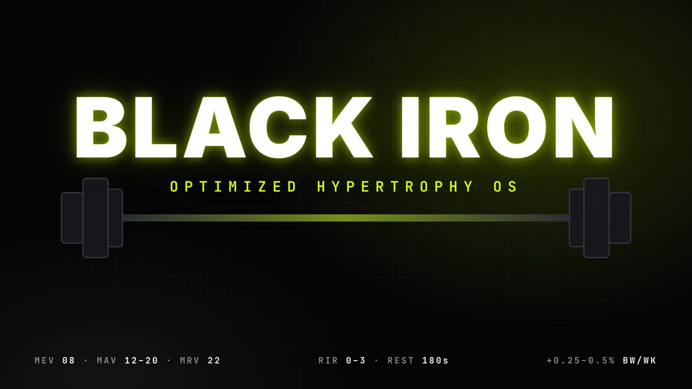

# BLACK IRON — Optimized Hypertrophy OS



App de celular (APK Android + PWA) para fisiculturistas naturais avançados: registro em 1 toque, dupla progressão, volume efetivo contra MEV/MAV/MRV, laboratório de bulk limpo, montador de dieta e fotos de antes e depois. Funciona offline, em **Português, English e Español**, com tema escuro e claro.

## 📱 Instalar no celular
- **Android (APK):** no celular, abra a aba **Releases** do repositório → baixe o `BlackIron-2.0.x.apk` mais recente → abra e permita "instalar apps desconhecidos". Cada push gera um APK novo automaticamente (`.github/workflows/android.yml`).
- **PWA:** em **Settings → Pages → Source: GitHub Actions**, ative o Pages. Cada push na `main` publica o site; no celular use "Adicionar à tela inicial".

## ⚙️ Módulos
| Módulo | O que faz |
|---|---|
| **A · Diário de treino** | Abre direto no treino do dia. Grade `SÉRIE · ANTERIOR · KG · REPS · RIR · ✓` com áreas de toque grandes; valores pré-preenchidos, **1 toque por série**. Seletor de RIR `0 F · 1 · 2 · 3 · 4+`. Cartão da sessão anterior (`100 kg × 8 @ 1 RIR`). **Dupla progressão:** topo da faixa com RIR ≤ 2 → brilho neon + "META ATINGIDA · +2 kg ou +1 rep". Cronômetro da série, nota por exercício, trocar/reordenar. |
| **B · Motor de volume** | Conta só **séries duras** (0–3 RIR, contagem fracionada: principal 1, secundário 0,5). Barras semanais por músculo contra **MEV/MAV/MRV**, mapa de calor no boneco, alerta acima do MRV (sugere deload), lista abaixo do MEV e contagem de séries lixo. Descanso auto-regulado pela complexidade (150–180 s em compostos pesados, 60–90 s em isolados) com ±30 s. Mesociclo de 5 semanas: RIR 3→2→1→0 e depois deload. |
| **C · Laboratório de bulk limpo** | Pesagem diária → **média móvel de 7 dias** (linha diária pontilhada + linha neon sólida), taxa semanal em %, **Guardião do Lean Bulk** (0,25–0,5 %/semana; avançados ≤ 0,35) com ajuste de kcal, **alarme de estagnação vs gordura** (peso subindo 3 semanas seguidas sem progresso de e1RM nos compostos). |
| **D · Biblioteca biomecânica** | **876 exercícios** com fotos da posição inicial/final, player (0,5×/1×/2×), **seu próprio vídeo de execução** gravado no celular e boneco anatômico (músculo trabalhado em vermelho, secundários em laranja, mais as principais funções). Metadados: **perfil de tensão**, **pico de torque (alongado/médio/encurtado)**, **custo SNC** e filtro ★ para exercícios que enfatizam a posição alongada. |
| **Dieta** | Mifflin-St Jeor, proteína 2,0 g/kg (bulk) / 2,3 g/kg (cut), plano de 3–6 refeições com valores aproximados da TACO/USDA, troca de alimento mantendo o macro principal, ajuste de ±10 g. |
| **Antes e depois** | Fotos por pose (frente/lado/costas), salvas só no aparelho, comparação deslizante, dias decorridos e diferença de peso. |
| **Ciência** | 17 estudos (Schoenfeld, Pelland, Refalo, Robinson, Pedrosa, Maeo, Kassiano, Iraki/Helms, Morton…) resumidos com minhas palavras, com link DOI e como o app aplica cada um. |

## 🧱 Arquitetura
```
src/core/        TypeScript puro e estritamente tipado (testado)
  training.ts    e1RM, dupla progressão, descanso, séries duras, MEV/MAV/MRV, mesociclo
  body.ts        média móvel, taxa de ganho, guardião do lean bulk, alarme de estagnação
  nutrition.ts   TMB/GET, macros, cálculo do plano de refeições
  generator.ts   gerador de programa com viés para posição alongada + volume projetado
src/db/          IndexedDB offline-first (estado + fotos/vídeos), backup, migração da v1
src/i18n/        PT / EN / ES
src/ui/          design system, boneco anatômico, gráficos SVG, componentes
src/screens/     Logger, Library, Training, Lab, Diet, Photos, More, Onboarding
android/         projeto Capacitor 6 (ícones/splash gerados)
scripts/         geração da base de exercícios (data/curated.mjs = biomecânica revisada)
```
Stack: React 18 + TypeScript (strict, `noUncheckedIndexedAccess`) + Vite + Capacitor. Sincronização em nuvem: não incluída (os dados ficam no aparelho; use o backup).

```bash
npm install
npm run dev        # desenvolvimento
npm test           # 17 testes (motor + i18n)
npm run build      # checagem de tipos + build de produção
npm run android    # build + cap sync (abrir no Android Studio: npx cap open android)
```

## 📚 Créditos e limites
- Fotos dos exercícios: [Free Exercise DB](https://github.com/yuhonas/free-exercise-db) (domínio público). Metadados de 134 exercícios revisados à mão; nos demais são estimados (marcados "~ estimado"). Instruções detalhadas em português para ~80 exercícios; os demais mostram as instruções em inglês.
- O player de demonstração anima as 2 fotos (início ↔ fim). Não há vídeos profissionais embutidos; a aba "Meu vídeo" grava a sua série e o botão **YT** busca um vídeo no YouTube.
- Livros de hipertrofia com direitos autorais (Schoenfeld, Helms, Israetel) não são distribuídos — os princípios estão implementados no app e citados.
- Ferramenta educativa. Não substitui profissionais de educação física, nutrição ou saúde.
